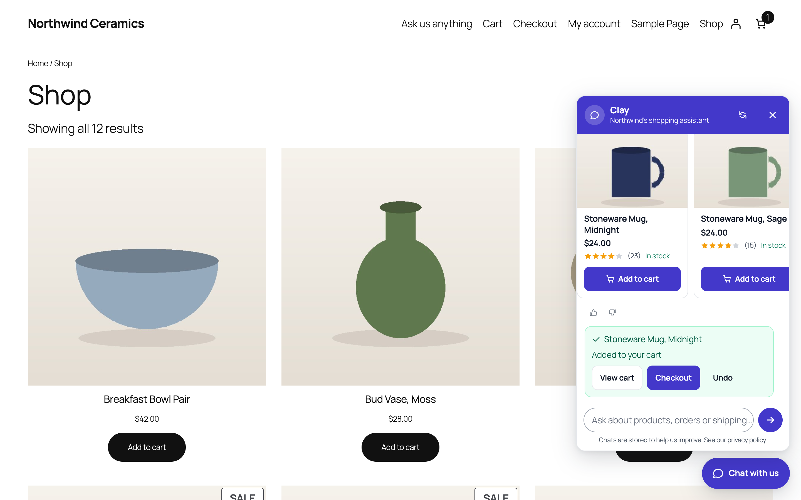

# DEV3 AI Shopping Assistant & Chatbot for WooCommerce

A shopping assistant chat that knows your catalog, orders and store policies. It recommends products, answers "where is my order", adds to the cart and hands over to your team. DEV3 AI (Google AI, your own key) makes it conversational.



## Features

Shoppers ask, the assistant answers from your live WooCommerce data: product cards with prices, stock and an Add to cart button, order status with tracking numbers, and your shipping, returns and payment answers. It is fully usable without AI (guided mode) and gets smarter with a Google AI key.

### Core features (no AI needed)
* Floating chat with launcher, greeting bubble, starter buttons, auto-open and page targeting; inline chat block and [dev3sa_chat] shortcode; [dev3sa_chat_button] opens the chat from any button or link (#dev3sa-chat).
* Built for phones: a full-screen sheet with safe-area insets that stays above the on-screen keyboard, 44px touch targets, back button closes it, no page scroll behind it.
* Product finder: keyword search over titles, SKUs, categories, tags and attributes; understands "under 50", "between 20 and 40", "on sale", "best sellers", "new".
* Add to cart from the chat (simple products), with View cart / Checkout / Undo; mini-carts refresh (classic and block).
* Order tracking: customers see their recent orders; guests enter order number + billing email. Status timeline, items, total and tracking numbers (Advanced Shipment Tracking and common meta keys). Addresses and payment details are never shown.
* Knowledge base: FAQ, shipping, returns and payment answers; one-click import from your refund page, terms, privacy page, shipping zones and payment methods.
* Talk to a person: handoff form emails your team with the transcript; WhatsApp and phone buttons; business hours with an away message.
* Conversations inbox with transcripts, statuses, email replies, CSV export; ratings (helpful / not helpful) on every answer.
* Dashboard: conversations, answer rate, add-to-carts, revenue from chat (attributed to orders, HPOS-safe), satisfaction, top and unanswered questions.
* Privacy: consent line, transcript retention, hashed IPs, GDPR export and erase.

### DEV3 AI features (optional, your own Google AI key)
* AI shopping chat with retrieval: semantic product and knowledge search (embeddings) plus keyword search; replies in the shopper's language; recommends only real products from your catalog; prices always come from WooCommerce.
* "Add the blue mug to my cart" adds the right product (validated server-side, undo available).
* Build my knowledge base: answers drafted from your policies and settings.
* Knowledge gaps: groups questions the assistant could not answer and drafts the missing answers.
* Conversation insights: themes, demand for products you don't sell, sentiment and actions.
* Persona writer: name, greeting, starter buttons and voice instructions in your brand voice.
* Test console: chat as a shopper and see why each answer was given.

Every admin AI result is a draft you accept, edit or reject. Storefront AI has a kill switch, a monthly budget cap, caching, a per-conversation AI limit and a rate limit, and falls back to the guided assistant whenever the AI is unavailable.

## Requirements

- WordPress 6.0 or newer (tested up to 6.8)
- PHP 7.4 or newer
- WooCommerce 8.0 or newer (required)
- Optional: your own Google AI API key (from Google AI Studio) to switch on the DEV3 AI features. The rest of the plugin works without one.

## Installation

### From the release zip

1. Download `dev3-ai-shopping-assistant-for-woocommerce.zip` from the [latest release](https://github.com/dev3tech/dev3-ai-shopping-assistant-for-woocommerce/releases/latest).
2. In WordPress, go to **Plugins → Add New → Upload Plugin**, choose the zip and click **Install Now**.
3. Click **Activate**.

### Build from source

```bash
git clone https://github.com/dev3tech/dev3-ai-shopping-assistant-for-woocommerce.git
cd dev3-ai-shopping-assistant-for-woocommerce
composer install --no-dev
npm ci
npm run build
```

Then copy the `dev3-ai-shopping-assistant-for-woocommerce` folder into `wp-content/plugins/` and activate it.

### Getting started

1. Upload the zip in Plugins › Add New › Upload Plugin and activate (WooCommerce must be active).
2. Open "DEV3 AI Assistant" in the admin menu.
3. Knowledge base › Import from store.
4. Optional: API Config › add your Google AI API key, then Knowledge base › Build index with DEV3 AI.

## FAQ

### Do I need an AI key?
No. Without a key the assistant runs in guided mode (product finder, order tracking, knowledge base, handoff).

### Is my API key exposed?
No. The key is stored encrypted on your server and every AI call happens server-side.

### Does it work with page caching?
Yes. The widget sends no nonce for guests and loads its data only when opened.

### Does it work with the block cart and checkout and HPOS?
Yes, both are declared compatible and attribution uses WooCommerce order CRUD.

## Privacy

When DEV3 AI is enabled, the shopper's message, the relevant product facts and knowledge entries are sent to Google AI (Google LLC) to write the answer. A privacy-policy text is added under Settings › Privacy. Transcripts are stored in your database for the retention period you choose (or one day when storage is off).

## Documentation

The full HTML guide (installation, settings, hooks and FAQ) is in [`docs/index.html`](docs/index.html). Open it in a browser after cloning or downloading the repository.

## Changelog

### 1.0.0
* First release.

## Licence

Released under the GNU General Public License v2.0 or later (GPL-2.0-or-later). See [LICENSE](LICENSE).

## More from DEV3

- [DEV3 AI Shopping Assistant & Chatbot for WooCommerce on the DEV3 Marketplace](https://www.dev3.tech/item/dev3-ai-shopping-assistant-for-woocommerce)
- [More WordPress plugins, themes and templates from DEV3](https://www.dev3.tech/marketplace)
